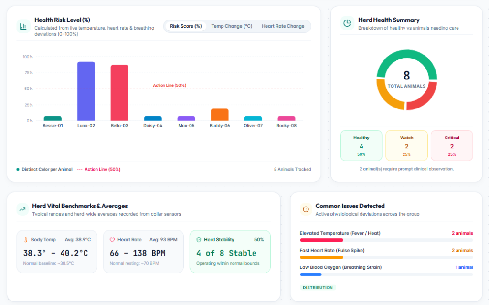

# M.A.V.I.S. — Multi-Modal Animal Vitality Intelligence System

> **An on-premises IoT telemetry and clinical screening platform combining wearable smart-collar sensing, streaming baseline evaluation, and an interactive web dashboard.**

[](docs/ARCHITECTURE.md)
[](frontend/)
[](hardware/esp32_collar/)
[](LICENSE)

---

## 1. Overview & Problem Statement

Continuous health monitoring in livestock and domestic animals is critical for detecting early onset diseases, respiratory distress, and heat strain. In traditional farm management, prey animals instinctively mask symptoms of pain and fever until illness is severely advanced, resulting in preventable mortality, reduced yields, and herd-wide contagion.

**M.A.V.I.S.** addresses this challenge by integrating:
- **Wearable Sensing**: An ESP32-based multi-sensor collar capturing optical photoplethysmography (PPG), core body temperature, 6-axis kinematics, and battery voltage.
- **Real-Time Gateway**: A local Node.js gateway that ingests telemetry, maintains personalized circadian baselines via Welford's algorithm, and computes multi-modal risk scores.
- **Interactive Dashboard**: A React single-page application providing biological digital twin monitoring, live herd matrix tracking, alert triage, and clinical action logs.
- **Simulation Workflow**: Built-in telemetry simulation daemon enabling complete evaluation and demonstration without requiring physical collar hardware.

> **Clinical Disclaimer**: M.A.V.I.S. is a project prototype designed for animal vitality monitoring and risk screening. Its risk scores and alerts are algorithmic indicators and do not constitute certified veterinary diagnoses.

---

## 2. Product Demonstration & Live Screenshots

### Live Animal Digital Twin & Collar Vitals
Real-time physiological telemetry (LoRa Link: 98%, 3s Interval) compared against individual learned circadian baselines, featuring 6-axis posture, optical skin contact, and cumulative alert breakdowns:


### Live Herd Telemetry Matrix & Priority Clinical Queue
Real-time status tracking across the entire herd with automated priority clinical queueing for immediate caregiver observation:


### Herd Health Summary & Risk Level Analytics
Group-wide risk scoring with a 50% clinical action line, herd health breakdown donut chart, and vital benchmarks:



---

## 3. Key Capabilities

* **Dual Telemetry Modes**: Operates with live **ESP32 physical collars** via HTTP POST or with the built-in **Telemetry Daemon** for zero-hardware evaluation.
* **Streaming Adaptive Baselines**: Evaluates vital signs against each animal's historical diurnal baseline using Welford's algorithm ($O(1)$ memory).
* **Non-Linear Risk Scoring**: Synthesizes multi-modal risk points with clinical synergy multipliers (e.g., febrile ruminal cessation for mastitis/acidosis screening).
* **Behavioral Classification**: Classifies resting, rumination chew rate, head shaking, and lying vs. standing posture.
* **Spatial Herd Epidemiology**: Estimates pathogen transmission risk between co-located animals in shared pens or grazing zones.
* **Alert Lifecycle Management**: Tracks alerts through `active` &rarr; `acknowledged` &rarr; `resolved` states.
* **Local-First AI Assistance**: Interfaces with on-premises Ollama models (`llama3.2`, `phi3`) with a deterministic safety fallback.
* **Clinical Records & Reports**: Interactive treatment logging and exportable 2-page veterinary audit reports.

---

## 4. System Architecture

The end-to-end data pipeline decouples sensor acquisition, validation, baseline computation, storage, and presentation:


### Subsystem & Processing Budget Audit

| Subsystem / Layer Module | Layer Description & Tensor/Payload Contract | Processing Frequency | Algorithmic Complexity | Execution Budget |
|---|---|---|---|---|
| **Optical PPG Acquisition** | MAX30102 Red & IR photodiode registers `[32-sample FIFO]` | 100 Hz (10 ms ticks) | $O(1)$ Peak Detect | Core 1 (APP_CPU) |
| **Motion Gating & True HRV** | Accelerometer gating $\sqrt{\sum a_i^2} > 15 \text{m/s}^2$ + RMSSD 8-beat RR window | 100 Hz (Event-triggered) | $O(N)$ where $N=8$ | Core 1 (APP_CPU) |
| **Inertial Rumination DSP** | MPU6050 Gyro Z zero-crossings ($0.25 \le \|\omega_z\| \le 1.8 \text{rad/s}$) | 100 Hz (Running integral) | $O(1)$ Zero-Crossing | Core 1 (APP_CPU) |
| **Subcutaneous Temp** | DS18B20 1-Wire non-blocking scratchpad read (`setWaitForConversion(false)`) | 0.33 Hz (Every 3 sec) | $O(1)$ Silicon Read | Core 1 (APP_CPU) |
| **Inter-Core Mailbox** | FreeRTOS Queue `[Length = 1, sizeof(TelemetryPacket)]` | Atomic overwrite | $O(1)$ Mailbox | FreeRTOS Kernel |
| **Edge Network Dispatch** | HTTPClient POST payload to `/api/sensor` | 0.33 Hz (Every 3 sec) | Non-blocking lwIP | Core 0 (PRO_CPU) |
| **Schema Ingestion & Joi** | Express Gateway input sanitization against strict Joi schema | Per request (<5 ms) | $O(K)$ field validation | Gateway Node.js |
| **Welford Baseline Engine** | Streaming continuous mean & variance ($\bar{x}_k, M_{2,k}, \sigma_k$) | Ingestion tick | $O(1)$ Constant RAM | Gateway Memory |
| **Spatial Herd Contagion** | Graph edge evaluation across shared pen co-presence matrix | Ingestion tick | $O(E)$ connected herd | Gateway Node.js |
| **Non-Linear Risk Scoring** | Multi-modal synergy engine ($1.35\times$ Febrile Ruminal Cessation) | Ingestion tick | $O(R)$ rules | Gateway Node.js |
| **Local SLM Cascade** | Ollama edge inference (`llama3.2:3b` / `phi3:mini`) + Deterministic Fallback | On-Demand (<3s) | 3B/4B quantized | Localhost GPU/CPU |
| **Client Digital Twin UI** | React 18 + TS Socket.IO consumer (`sensorUpdate`, `alert`) | Real-time push | 60 FPS re-render | Client Browser |

*For detailed algorithmic formulations, synergy equations, and graph math, see [docs/ARCHITECTURE.md](docs/ARCHITECTURE.md).*

---

## 5. Technology Stack

| Layer | Technologies |
|---|---|
| **Embedded Hardware** | ESP32 (Xtensa LX6), FreeRTOS Dual-Core, Arduino C++ Framework |
| **Sensors** | MAX30102 ($\text{SpO}_2$, HR, HRV), DS18B20 (Core Temp), MPU6050 (6-Axis IMU) |
| **Backend Gateway** | Node.js, Express.js (Vertical Feature Slices), Joi Validation |
| **Database & Cache** | MongoDB, Mongoose (with automated In-Memory MongoDB Fallback) |
| **Real-Time Communication** | Socket.IO (`sensorUpdate`, `alert`, `alert:updated`) |
| **Frontend Dashboard** | React 18, TypeScript, Vite, Tailwind CSS, Lucide Icons |
| **Data Visualization** | Recharts (Multi-series historical timelines, reference bands) |
| **Local AI Inference** | Ollama (`llama3.2:3b`, `phi3:mini`) with Deterministic Clinical Fallback |
| **Orchestration** | Docker & Docker Compose |

---

## 6. Repository Layout

```text
MAVIS/
├── backend/                  # Express REST API, health engine, and services
│   ├── features/             # Feature slices (animals, sensors, alerts, auth, etc.)
│   ├── config/               # Environment configuration and database setup
│   ├── tests/                # Automated unit test suite (run-tests.js)
│   └── .env.example          # Environment variable template
├── frontend/                 # React 18 + TypeScript SPA
│   ├── src/features/         # Feature modules (digital-twin, animals, dashboard, etc.)
│   └── src/shared/           # Shared UI primitives, contexts, and API client
├── hardware/
│   └── esp32_collar/         # Production ESP32 FreeRTOS firmware (esp32_collar.ino)
├── docs/                     # Extended technical documentation
│   ├── ARCHITECTURE.md       # Deep architectural design and mathematical formulas
│   ├── API.md                # Complete REST endpoints and WebSocket event schemas
│   ├── HARDWARE_SETUP.md     # Wiring diagrams, pinouts, and flashing instructions
│   └── images/               # Screenshots and architecture diagrams
├── postman/                  # API testing collections and environments
├── presentation_assets/      # Slide graphics and risk engine diagrams
└── docker-compose.yml        # Multi-container orchestration definition
```

---

## 7. Getting Started

### Prerequisites
- **Node.js**: `v18.0.0` or higher (Node 20+ recommended)
- **npm**: `v9.0.0` or higher
- **Git**
- *(Optional)* **Docker & Docker Compose**
- *(Optional)* **Ollama**: For local language model summaries (`ollama run llama3.2`)

---

### Step 1: Clone the Repository
```bash
git clone https://github.com/Dheemanth07/M.A.V.I.S.git
cd M.A.V.I.S
```

### Step 2: Configure Backend Environment
Copy the example environment configuration:
```bash
cp backend/.env.example backend/.env
```

> **Zero-Config Database Fallback**: If you do not have a local MongoDB instance running, the backend automatically boots an **in-memory MongoDB database**. No manual database installation is required for development or testing.

### Step 3: Start the Backend Gateway
```bash
cd backend
npm install
npm run dev
```
The gateway starts on `http://localhost:5000`. Verify by opening `http://localhost:5000/health`.

### Step 4: Start the Frontend Dashboard
In a separate terminal:
```bash
cd frontend
npm install
npm run dev
```
Open the URL printed by Vite (typically `http://localhost:5173`).

---

## 8. Docker Deployment

To launch the backend service via Docker Compose:
```bash
docker compose up --build
```
Ensure `backend/.env` exists before starting the container.

---

## 9. Testing & Verified Results

All subsystems include automated test suites verified in the current environment:

### Backend Unit Tests
```bash
cd backend
npm test
```
**Verified Result**: `17 / 17 tests passed (0 failures)`
- Normal vital homeostasis evaluation
- Fever and hypothermia classification
- Non-linear synergy multipliers (febrile ruminal cessation)
- Behavioral agitation with tachycardia
- Depressed HRV autonomic stress (<20 ms)
- Species susceptibility weights and herd contagion risk decay
- Circadian diurnal baseline calculations
- Express route mounting and Socket.IO initialization

### Frontend Linter & Build Verification
```bash
cd frontend
npm run lint
npm run build
```
**Verified Result**:
- `oxlint`: 0 warnings, 0 errors across 32 files.
- `vite build`: Production bundle transformed and minified cleanly in 959 ms.

---

## 10. Hardware Configuration Summary

The smart collar firmware ([esp32_collar.ino](hardware/esp32_collar/esp32_collar.ino)) defines the following connections:

| Component | Pin | Function |
|---|---|---|
| **MAX30102** | SDA (GPIO 21), SCL (GPIO 22) | Optical PPG ($\text{SpO}_2$, HR, HRV) over I2C |
| **MPU6050** | SDA (GPIO 21), SCL (GPIO 22) | 6-Axis Accelerometer & Gyroscope over I2C |
| **DS18B20** | Data (GPIO 4) + 4.7kΩ Pull-up | Subcutaneous Temperature over 1-Wire (Async) |
| **LiPo ADC** | ADC1_CH6 (GPIO 34) via 2:1 divider | Battery level percentage (0–100%) |

*For complete wiring diagrams, power calculations, and the captive portal provisioning flow, refer to [docs/HARDWARE_SETUP.md](docs/HARDWARE_SETUP.md).*

---

## 11. API & WebSocket Events Summary

The backend exposes RESTful endpoints under `/api`:
- `/api/animals`: Animal records, profiles, and health aggregations.
- `/api/sensor` & `/api/sensors`: Real-time telemetry ingestion and historical queries.
- `/api/alerts`: Active alerts, acknowledgments, and resolutions.
- `/api/auth`: User registration, session login, and settings.
- `/api/ai`: On-demand clinical insights synthesis.

Real-time telemetry and alerts are broadcast via Socket.IO:
- `sensorUpdate` / `sensor:update`: Real-time telemetry packet.
- `alert`: Anomaly or threshold violation notification.
- `alert:updated`: Alert state transitions.

*For complete request payloads, response bodies, and token requirements, refer to [docs/API.md](docs/API.md).*

---

## 12. Current Scope & Known Limitations

1. **Screening vs. Diagnosis**: Risk scores indicate statistical deviations from baseline and do not replace professional veterinary evaluation.
2. **Telemetry Sources**: The system supports both real hardware and simulated daemon data. Demonstration charts reflect the active data source.
3. **Sensor Sensitivity**: Optical PPG and skin temperature readings are subject to ambient temperature, probe placement, fur density, and movement.
4. **Local SLM Availability**: AI narrative assessments require Ollama to be running locally with the target model downloaded. If unavailable, the deterministic fallback engine activates.

---

## 13. License

This project is licensed under the [MIT License](LICENSE).
