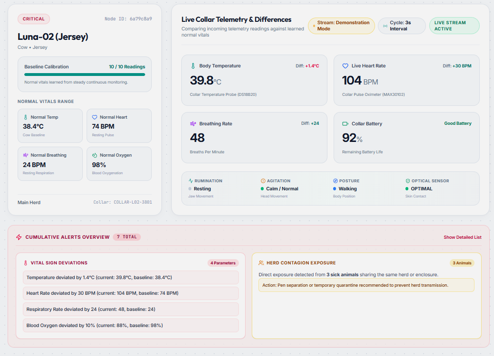
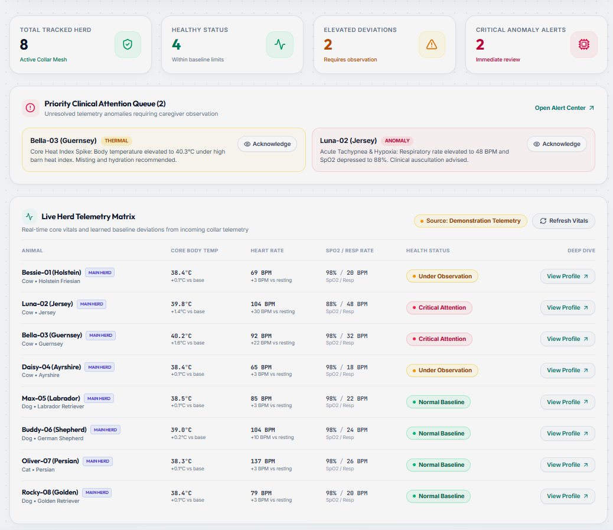

# M.A.V.I.S. — Multi-Modal Animal Vitality Intelligence System

> **An IoT-based animal health monitoring platform combining wearable smart-collar sensing, real-time telemetry, health-risk evaluation, and an interactive web dashboard.**

[](frontend/)
[](hardware/esp32_collar/)
[](LICENSE)

---

## Overview

Continuous animal monitoring helps caretakers and farm managers identify subtle deviations in vital signs and behavioral patterns before conditions escalate. **M.A.V.I.S.** combines wearable sensor acquisition, streaming data ingestion, rule-based risk evaluation, and local AI assistance into a unified monitoring dashboard.

The system supports two complementary workflows:
* **Hardware Telemetry**: An ESP32 smart collar reading temperature, optical photoplethysmography (PPG), and 6-axis kinematics, pushing telemetry packets over Wi-Fi.
* **Demonstration Simulation**: A built-in telemetry daemon capable of generating realistic multi-animal streams for software evaluation without physical hardware.

> **Project Disclaimer**: M.A.V.I.S. is an engineering prototype designed for health monitoring and risk screening. Its risk scores and alerts are algorithmic indicators and do not replace diagnostic assessment by a qualified veterinarian.

---

## Key Capabilities

* **Wearable Sensor Integration**: ESP32 firmware running FreeRTOS tasks to acquire optical pulse data (MAX30102), temperature readings (DS18B20), and motion indicators (MPU6050).
* **Streaming Adaptive Baselines**: Calculates individualized diurnal baselines and dynamic Z-scores using Welford's algorithm ($O(1)$ memory).
* **Multi-Modal Risk Evaluation**: Evaluates composite risk scores with synergy weighting (e.g., elevated temperature paired with dropped rumination).
* **Behavioral Indicators**: Derives rumination chew frequency, head-shaking agitation, and lying versus standing posture.
* **Heuristic Herd Exposure**: Graph-based exposure risk estimates across animals sharing enclosures or pens.
* **Alert Lifecycle Management**: Tracks alerts through `active` &rarr; `acknowledged` &rarr; `resolved` states with live Socket.IO delivery.
* **Local Inference Support**: Optional integration with Ollama language models for diagnostic narrative generation, backed by an in-memory deterministic fallback.

---

## Screenshots

### Animal Digital Twin & Live Telemetry
Individual subject deep-dive (Luna-02 Jersey cow) comparing live collar sensor readings against personalized learned baseline ranges, featuring real-time 3-second telemetry streaming, optical photodiode contact status, behavioral posture indicators, and cumulative alert breakdowns:



### Live Herd Telemetry Matrix & Priority Queue
Multi-subject clinical triage view tracking real-time vital deviations across the entire group alongside an immediate clinical observation queue with caregiver acknowledgment:



*Screenshots show the monitoring dashboard running live demonstration telemetry. Real-time collar data updates at 3-second intervals.*

---

## System Architecture

The pipeline separates physical sensor acquisition, REST ingestion, statistical risk evaluation, persistent storage, real-time WebSocket broadcast, and client visualization into five decoupled tiers:


For detailed algorithmic formulations, baseline mathematics, and synergy rules, see [docs/ARCHITECTURE.md](docs/ARCHITECTURE.md).

---

## Technology Stack

| Layer | Technologies |
|---|---|
| **Embedded Hardware** | ESP32 (Xtensa LX6), FreeRTOS, Arduino C++ Framework |
| **Collar Sensors** | MAX30102 (PPG / $\text{SpO}_2$ / HRV), DS18B20 (Temperature), MPU6050 (6-Axis IMU) |
| **Backend Gateway** | Node.js, Express.js (Vertical Feature Slices), Joi Validation |
| **Database Storage** | MongoDB, Mongoose (with automated In-Memory MongoDB Fallback) |
| **Real-Time Communication** | Socket.IO (`sensorUpdate`, `alert`, `alert:updated`) |
| **Frontend Dashboard** | React 19, TypeScript, Vite, Tailwind CSS, Lucide Icons |
| **Charts & Visualization** | Recharts (Historical timelines and reference bands) |
| **Local AI Assistance** | Ollama (`llama3.2:3b`, `phi3:mini`) with Deterministic Fallback |
| **Containerization** | Docker & Docker Compose |

---

## Repository Structure

```text
MAVIS/
├── backend/                  # Express REST API, health engine, and services
│   ├── features/             # Domain feature slices (animals, sensors, alerts, auth)
│   ├── config/               # Environment configuration and database setup
│   ├── tests/                # Automated unit test suite (run-tests.js)
│   └── .env.example          # Environment variable template
├── frontend/                 # React 19 + TypeScript SPA
│   ├── src/features/         # Feature modules (digital-twin, animals, dashboard)
│   └── src/shared/           # Shared UI primitives, contexts, and API client
├── hardware/
│   └── esp32_collar/         # ESP32 FreeRTOS collar firmware (esp32_collar.ino)
├── docs/                     # Detailed technical documentation
│   ├── ARCHITECTURE.md       # Architectural decisions and mathematical models
│   ├── API.md                # Complete REST endpoints and WebSocket event schemas
│   ├── HARDWARE_SETUP.md     # Wiring diagrams, pinouts, and flashing instructions
│   └── images/               # Screenshots and architecture diagrams
├── postman/                  # API testing collections and environments
└── docker-compose.yml        # Docker Compose definition (runs backend service)
```

---

## Getting Started

### Prerequisites
* **Node.js**: `v20.19.0` or higher (Node 22 LTS recommended)
* **npm**: `v9.0.0` or higher
* **Git**
* *(Optional)* **Ollama**: For local language model summaries (`ollama run llama3.2`)
* *(Optional)* **Docker & Docker Compose**

---

### 1. Clone the Repository
```bash
git clone https://github.com/Dheemanth07/M.A.V.I.S.git
cd M.A.V.I.S
```

### 2. Configure Backend Environment
Copy the example environment file:
```bash
cp backend/.env.example backend/.env
```
Review `backend/.env` to configure port, database URI, or secrets if desired.

> **Database Fallback**: If a local MongoDB instance is not detected on `MONGO_URI`, the backend automatically starts an **in-memory MongoDB database**. No manual database installation is required for development or demonstration.

### 3. Start the Backend Gateway
```bash
cd backend
npm install
npm run dev
```
The gateway starts on `http://localhost:5000`. Verify by visiting `http://localhost:5000/health`.

### 4. Start the Frontend Dashboard
In a separate terminal:
```bash
cd frontend
npm install
npm run dev
```
Open the local URL printed by Vite (typically `http://localhost:5173`).

### 5. Sign In to the Demonstration Herd
To explore the complete 8-animal multi-species herd, active anomaly alerts, and calibrated baseline profiles shown in the screenshots, sign in with the pre-provisioned demonstration credentials:
* **Email**: `dheemanth1007@gmail.com`
* **Password**: `dheemanth@123`

*(Note: Newly registered custom accounts start with an empty dashboard to allow onboarding fresh subjects from scratch.)*

---

## Running with Docker

The repository includes a Docker Compose definition to run the backend gateway:
```bash
docker compose up --build
```
Ensure that `backend/.env` exists before building the container.

---

## Testing & Verification

Run the backend unit test suite:
```bash
cd backend
npm test
```
*Executes 17 test suites covering risk evaluation, baseline calibration, circadian rhythm, and herd contagion models.*

Run frontend linting and build validation:
```bash
cd frontend
npm run lint
npm run build
```

---

## Hardware & API Reference

* **Hardware Wiring & Firmware**: Complete component pinouts, 1-Wire pull-up wiring, FreeRTOS tasks, and captive portal provisioning are documented in [docs/HARDWARE_SETUP.md](docs/HARDWARE_SETUP.md).
* **API Endpoints & WebSocket Events**: Full request schemas, response formats, authentication requirements, and Socket.IO contracts are documented in [docs/API.md](docs/API.md).
* **Deep Architecture & Formulas**: Mathematical models for Welford's algorithm, synergy weighting, and graph exposure are documented in [docs/ARCHITECTURE.md](docs/ARCHITECTURE.md).

---

## Current Scope & Limitations

* **Screening Aid**: Risk scores indicate statistical deviations from baseline and do not constitute certified veterinary diagnoses.
* **Telemetry Modes**: The dashboard displays live data from either a connected ESP32 collar or the simulation daemon depending on the active setup.
* **Measurement Factors**: Temperature probe and optical pulse readings are subject to sensor placement, skin/fur contact, ambient conditions, and animal movement.
* **Local Inference**: AI narrative summaries require an active local Ollama instance with supported models. If unavailable, the system operates on the deterministic fallback engine.

---

## License

This project is licensed under the [MIT License](LICENSE).
