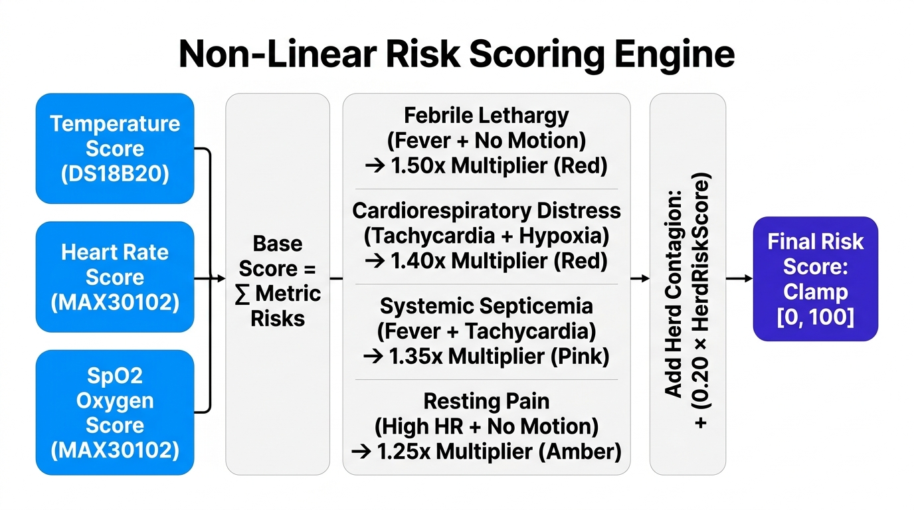

# M.A.V.I.S. — Deep System Architecture & Algorithmic Formulation

This document provides a comprehensive technical breakdown of the architecture, mathematical formulations, and engineering decisions implemented in M.A.V.I.S. (Multi-Modal Animal Vitality Intelligence System).

---

## 1. High-Level Data Flow

The system is decoupled into three primary execution tiers:
1. **Edge Hardware Layer**: Embedded ESP32 firmware running a dual-core FreeRTOS architecture. Core 1 samples the MAX30102 pulse oximeter, MPU6050 6-axis IMU, and DS18B20 1-Wire temperature probe at 100 Hz. Core 0 handles network dispatch, pushing structured JSON telemetry packets over Wi-Fi/HTTP every 3 seconds.
2. **Backend Gateway & Ingestion**: Node.js/Express server providing input schema validation (Joi), persistent time-series ingestion (MongoDB), adaptive baseline computation, multi-modal risk scoring, and spatial herd contagion tracking.
3. **Frontend Digital Twin & Presentation**: React 18 + TypeScript single-page application receiving real-time WebSocket events (`sensorUpdate`, `alert`) via Socket.IO, rendering 24-hour/7-day historical trends, and providing clinical audit logging.

---

## 2. Adaptive Baseline Engine (Welford's Algorithm)

Rather than evaluating all animals against rigid, arbitrary thresholds, M.A.V.I.S. computes personalized circadian baselines using **Welford’s Algorithm** for numerically stable, streaming one-pass mean and variance calculation.

### Mathematical Formulation
Given a continuous stream of observations $x_1, x_2, \dots, x_k$ for a vital sign (e.g., Core Body Temperature):

$$\bar{x}_k = \bar{x}_{k-1} + \frac{x_k - \bar{x}_{k-1}}{k}$$

$$M_{2,k} = M_{2,k-1} + (x_k - \bar{x}_{k-1})(x_k - \bar{x}_k)$$

$$\sigma_k = \sqrt{\frac{M_{2,k}}{k - 1}} \quad (k \ge 2)$$

From this streaming variance, the dynamic Z-Score is derived in $O(1)$ constant memory:

$$Z = \frac{|x_{current} - \bar{x}_{baseline}|}{\max(\sigma_k, \sigma_{min})}$$

* Where $\sigma_{min} = 1.0$ serves as a variance floor preventing division-by-zero during resting homeostasis.
* When $Z \ge 2.5$, an individual vital deviation alert is triggered even if the absolute value falls within population-wide limits.

---

## 3. Multi-Modal Risk Scoring Engine

The clinical evaluation engine combines physiological thresholds with 6-axis behavioral state and environmental context. Rather than simple additive scoring, it models **pathophysiological synergies**:

### Non-Linear Synergy Multipliers
1. **Febrile Ruminal Cessation**:
   When core body temperature indicates a fever ($T \ge 40.0^\circ\text{C}$) while rumination ceases ($\text{rumination} = \text{false}$), the engine flags acute bovine mastitis or ruminal acidosis risk with a **$1.35\times$ synergy multiplier**.
2. **Behavioral Agitation with Tachycardia**:
   When continuous head shaking ($\text{angularRate} > 3.5\text{ rad/s}$) coincides with elevated heart rate ($\text{HR} \ge 140\text{ BPM}$), the engine flags parasitic infestation (ticks/flies) or acute neurological distress.
3. **Depressed Heart Rate Variability ($\text{HRV}$)**:
   When true optical $\text{RMSSD} < 20\text{ ms}$, the engine adds high-priority autonomic stress points, indicating pain, endotoxemia, or shock.

$$\text{Final Risk Score} = \min\left(100, \, \left(\sum \text{Base Risk Points}\right) \times \prod \text{Synergy Multipliers}\right)$$

---

## 4. Spatial Herd Contagion Graph

When an animal in an enclosed pen or pasture develops a contagious respiratory or febrile profile, M.A.V.I.S. assesses exposure likelihood across all co-located subjects.

### Epidemiological Formulation
The transmission probability between index subject $i$ and neighboring subject $j$ sharing zone $Z$ over duration $\Delta t$ is computed as:

$$P_{\text{contagion}}(i, j) = 1 - \exp\left(-\beta \cdot w_{\text{species}} \cdot \Delta t_{\text{shared}}\right)$$

* $\beta$: Transmission coefficient calibrated by ventilation and contact density ($0.85$ for enclosed barn, $0.35$ for open pasture).
* $w_{\text{species}}$: Species susceptibility weight (e.g., $1.0$ for cross-cattle transmission, $0.6$ for inter-species contact).

---

## 5. Local-First AI Inference & Deterministic Safety Cascade

For diagnostic summaries and differential assessments, M.A.V.I.S. uses on-premises Small Language Models (SLMs) via Ollama:

1. **Primary Model**: `llama3.2:3b` / `llama3.2:1b` (optimized for edge reasoning).
2. **Secondary Fallback**: `phi3:mini` / `phi3`.
3. **Deterministic Safety Engine**: If the Ollama runtime is offline or unresponsive within a 5-second timeout, the system automatically falls back to an in-memory rule-based evaluation matrix that generates structured clinical actions with zero downtime.
