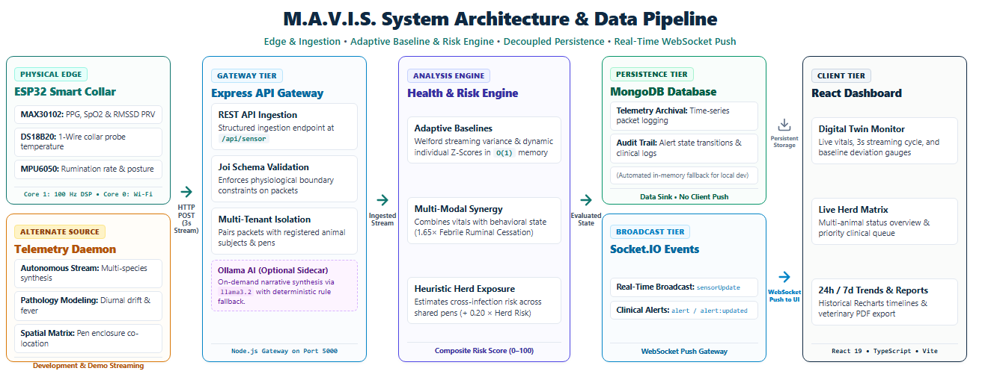

# M.A.V.I.S. — Deep System Architecture & Algorithmic Formulation

This document provides a technical breakdown of the architecture, algorithmic formulations, and design decisions implemented in M.A.V.I.S. (Multi-Modal Animal Vitality Intelligence System).

---

## High-Level System Architecture & Data Flow

The system pipeline organizes data acquisition, statistical baseline learning, and risk evaluation into clear functional stages:
1. **Edge Sensing Layer**: The ESP32 firmware executes a FreeRTOS dual-core loop. Core 1 samples the MAX30102 pulse oximeter, MPU6050 6-axis IMU, and DS18B20 1-Wire temperature probe. Core 0 handles network dispatch, transmitting structured JSON telemetry packets over Wi-Fi/HTTP every 3 seconds.
2. **Gateway Ingestion & Evaluation**: The Node.js/Express gateway provides request schema sanitization via Joi, time-series storage in MongoDB, adaptive baseline computation, multi-modal risk scoring, and heuristic herd-exposure estimates.
3. **Client Presentation**: The React 19 + TypeScript dashboard consumes real-time WebSocket events (`sensorUpdate`, `alert`) via Socket.IO, displaying digital twin vitals, multi-animal status matrices, historical trend charts, and clinical action logs.
4. **Supporting Workflows**:
   - *Simulation Daemon*: Background service capable of generating synthetic telemetry for development and demonstrations without a physical collar connected.
   - *Optional Local AI*: Integration with Ollama for narrative summaries, with automatic fallback to an in-memory rule engine.

---

## Adaptive Baseline Engine (Welford's Algorithm)

Rather than evaluating all animals against rigid, static thresholds, M.A.V.I.S. computes individualized baselines using **Welford’s Algorithm** for numerically stable, streaming one-pass mean and variance calculation.

### Mathematical Formulation
Given a continuous stream of observations $x_1, x_2, \dots, x_k$ for a vital sign (e.g., temperature probe reading):

$$\bar{x}_k = \bar{x}_{k-1} + \frac{x_k - \bar{x}_{k-1}}{k}$$

$$M_{2,k} = M_{2,k-1} + (x_k - \bar{x}_{k-1})(x_k - \bar{x}_k)$$

$$\sigma_k = \sqrt{\frac{M_{2,k}}{k - 1}} \quad (k \ge 2)$$

From this streaming variance, the dynamic Z-Score is derived in $O(1)$ constant memory:

$$Z = \frac{|x_{\text{current}} - \bar{x}_{\text{baseline}}|}{\max(\sigma_k, \sigma_{\text{min}})}$$

* Where $\sigma_{\text{min}} = 1.0$ serves as a variance floor preventing division-by-zero during resting periods.
* When $Z \ge 2.5$, an individual vital deviation alert is flagged even if the raw value falls within general species bounds.

---

## Multi-Modal Health-Risk Scoring Engine

The health evaluation engine combines physiological thresholds with 6-axis behavioral state and environmental context. In `calculateRiskScore.js`, the engine applies **multi-modal synergy multipliers** when related warning signs occur concurrently:

### Implemented Synergy Multipliers
1. **Febrile Ruminal Cessation ($1.65\times$)**:
   When an elevated temperature indicates a fever while rumination drops or ceases (`context.rumination === false`), the engine increases the composite score by $1.65\times$ (useful for screening acute mastitis or ruminal acidosis).
2. **Febrile Lethargy ($1.50\times$)**:
   When a fever coincides with absence of motion or prolonged lying down (`context.motion === false || context.lyingDown === true`), a $1.50\times$ multiplier is applied.
3. **Cardiorespiratory Distress ($1.40\times$)**:
   When tachycardia coincides with low blood oxygenation (`hasTachycardia && isHypoxic`), a $1.40\times$ multiplier is applied.
4. **Febrile Tachycardia / Systemic Stress ($1.35\times$)**:
   When elevated body temperature coincides with a significant heart rate elevation (`isFebrile && hasTachycardia`), a $1.35\times$ multiplier is applied.
5. **Neuro-Parasitic Agitation ($1.30\times$)**:
   When persistent head shaking coincides with an abnormal pulse rate (`hasTachycardia && context.headShaking === true`), a $1.30\times$ multiplier flags potential ear tick irritation or neurological distress.
6. **Resting Tachycardia / Acute Pain ($1.25\times$)**:
   When heart rate is significantly elevated during periods of zero motion in the absence of fever, a $1.25\times$ multiplier is applied.

### Composite Formulation & Herd Contribution
The individual vital evaluations are multiplied by the dominant active synergy multiplier, and then augmented by a proportion of the shared pen/enclosure herd contagion risk:

$$\text{Final Risk Score} = \min\left(100, \, \left\lfloor \left(\sum R_{\text{base}}\right) \times \max(1.0, S_{\text{synergy}}) \right\rceil + \left\lfloor 0.20 \times R_{\text{herd}} \right\rceil\right)$$

* $\sum R_{\text{base}}$: Sum of individual biometric penalty scores (temperature, heart rate, respiration, $\text{SpO}_2$, activity).
* $S_{\text{synergy}}$: The maximum applicable multi-modal synergy multiplier (or $1.0$ if no cross-sensor synergies are triggered).
* $R_{\text{herd}}$: The co-located herd exposure risk score derived from `herdGraph.service.js`. Adding $20\%$ of this environmental risk accounts for herd contagion pressure on susceptible animals before clamping the final composite score to $[0, 100]$.

---

## Heuristic Herd Exposure Graph

When an animal in an enclosed pen or pasture develops an elevated risk profile, M.A.V.I.S. estimates potential exposure across co-located herd members using a weighted interaction model in `herdGraph.service.js`:

$$R_{\text{exposure}}(i) = \sum_{j \neq i} \left( R(j) \cdot W_{\text{species}}(i, j) \cdot W_{\text{zone}}(i, j) \right)$$

### Weight Configuration
* **Zone Weight ($W_{\text{zone}}$)**:
  - $0.90$ if both subjects share the exact same pen, enclosure, or herd zone.
  - $0.05$ if subjects are separated by a barrier or either subject is assigned to an isolation/quarantine pen.
* **Species Susceptibility ($W_{\text{species}}$)**:
  - $1.00$ for intra-species contact (e.g., cow to cow).
  - $0.35$ for cross-ruminant contact (e.g., cattle and sheep).
  - $0.05$ for non-ruminant domestic animals.

This provides an automated screening indicator to suggest pen separation or observation before contagion spreads.

---

## Hybrid Grounded Clinical Decision & SLM Intelligence

M.A.V.I.S. implements a **2-tier Hybrid Grounded Architecture** combining deterministic clinical safety with local generative AI:
1. **Tier 1 — Deterministic Clinical Safety Engine (CDSE)**:
   - Evaluates multi-modal sensor telemetry against clinical veterinary decision matrices in pure Node.js ($<1\text{ ms}$).
   - Locks the clinical risk tier (`critical`, `warning`, `healthy`) and differential diagnoses with 100% reproducibility and zero hallucination risk.
2. **Tier 2 — Local SLM Narrative Synthesizer (Ollama)**:
   - When a local Ollama instance is active (`http://127.0.0.1:11434`), lightweight edge models (`llama3.2:3b`, `phi3:mini`) translate the deterministic findings into rich, natural-language caregiver summaries.
   - The SLM's prompt is strictly constrained by Tier 1 diagnostic bounds to prevent hallucinated conditions.
   - If Ollama is offline or slow, the system seamlessly falls back to Tier 1 instantly without UI delay.
